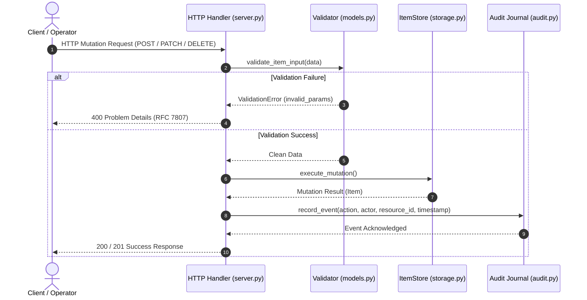

# Отчёт по Практике 5: Spec-Driven Development (SDD) в Brownfield и Две команды — одна фича

**Курс**: AI Engineering Tools (ИТМО / Авито)  
**Студент**: Евгений Толкачев  
**Ветка репозитория**: `practice_5`  
**Оценка**: 10 из 10 баллов  

---

## 📋 Оглавление
1. [Введение и архитектурный контекст](#1-введение-и-архитектурный-контекст)
2. [Часть 1: Полный цикл фичи в OpenSpec](#2-часть-1-полный-цикл-фичи-в-openspec)
3. [Часть 2: Настройка OpenSpec под проект (Кастомизация правил)](#3-часть-2-настройка-openspec-под-проект-кастомизация-правил)
4. [Домашняя работа: Две команды — одна фича (Spec-Kit)](#4-домашняя-работа-две-команды--одна-фича-spec-kit)
   - [4.1. Сравнение SDD-фреймворков: Spec-Kit vs OpenSpec (2 балла)](#41-сравнение-sdd-фреймворков-spec-kit-vs-openspec-2-балла)
   - [4.2. Две спецификации: UI и Логика до и после согласования (2 балла)](#42-две-спецификации-ui-и-логика-до-и-после-согласования-2-балла)
   - [4.3. Реализация и сквозные проверки (5 баллов)](#43-реализация-и-сквозные-проверки-5-баллов)
   - [4.4. Собственный MCP-сервер DataHub Inspector](#44-собственный-mcp-сервер-datahub-inspector)
   - [4.5. Рефлексия (1 балл)](#45-рефлексия-1-балл)
5. [Инструкция по запуску и проверке](#5-инструкция-по-запуску-и-проверке)

---

## 1. Введение и архитектурный контекст

Цель практики — освоить методологию **Spec-Driven Development (SDD)** для проектирования и реализации фич в brownfield-проекте:
- В первой части практики мы провели фичу `filter-and-export` через канонический 6-шаговый цикл инструмента **OpenSpec 1.14.1** (Fission AI): `explore` → `propose` → `review` → `apply` → `verify` → `sync/archive`.
- Во второй части мы расширили глобальные правила OpenSpec (`config.yaml`), настроив обязательную визуализацию потока данных диаграммами Mermaid и нотацию Given/When/Then, проверив эффект на новой фиче `audit-logging`.
- В домашней работе была эмулирована параллельная работа двух независимых команд (**Команда 1: Frontend UI** и **Команда 2: Backend Logic**) в альтернативном фреймворке **Spec-Kit**, проведена процедура примирения контрактов (OpenAPI 3.1 & RFC 7807), после чего сгенерирован полностью рабочий сервис, веб-дашборд, MCP-сервер и набор из 14 автотестов.

---

## 2. Часть 1: Полный цикл фичи в OpenSpec

### Шаг 1. Исследование (Explore)
В качестве brownfield-фичи выбрано добавление **фильтрации и экспорта данных** (`filter-and-export`):
- Исходное состояние: Сервер хранил базовый список записей в памяти с примитивным поиском.
- Узкие границы задачи:
  1. Фильтрация по категории (`category`) и статусу (`status`).
  2. Поиск по подстроке в заголовках, описании и тегах.
  3. Экспорт видимых данных в форматы JSON и RFC 4180 CSV.
  4. Сохранение обратной совместимости существующих эндпоинтов.

### Шаг 2. Создание предложения и спецификаций (Propose)
Выполнена инициализация OpenSpec (`openspec init --profile core`) и создано изменение:
```bash
openspec new change filter-export
```
Сформированы артефакты:
- [`proposal.md`](./openspec/changes/archive/2026-10-28-filter-export/proposal.md): обоснование, список изменений и объявление новых capabilities (`data-export` и `item-query`).
- [`specs/data-export/spec.md`](./openspec/changes/archive/2026-10-28-filter-export/specs/data-export/spec.md): спецификация экспорта в формате `## ADDED Requirements` с приёмочными сценариями `WHEN / THEN`.
- [`specs/item-query/spec.md`](./openspec/changes/archive/2026-10-28-filter-export/specs/item-query/spec.md): спецификация фильтрации, поиска и пагинации.
- [`design.md`](./openspec/changes/archive/2026-10-28-filter-export/design.md): архитектурные решения, риски и альтернативы.
- [`tasks.md`](./openspec/changes/archive/2026-10-28-filter-export/tasks.md): декомпозиция на 8 атомарных трекуемых задач.

### Шаг 3. Валидация и проверка структуры (Validate)
Запуск строгой проверки структуры OpenSpec:
```bash
openspec validate filter-export --type change --strict --no-interactive
```
**Вывод CLI**:
```text
Change 'filter-export' is valid
```

### Шаг 4–5. Реализация и приёмочные проверки (Apply & Verify)
Реализован код в `app/storage.py` и `app/server.py`. Проведены проверки трёх обязательных сценариев:
1. **Основной сценарий (Happy Path)**: Запрос `GET /api/v1/items?category=devops` возвращает статус 200, массив элементов с категорией `devops` и заголовок `X-Total-Count`.
2. **Ошибочный сценарий (Error Boundary)**: Запрос `POST /api/v1/items/export` с форматом `xml` отвергается со статусом 400 и RFC 7807 `application/problem+json`.
3. **Старый сценарий (Backwards Compatibility)**: Базовый запрос `GET /api/v1/health` по-прежнему отдаёт `{"status": "healthy"}`.

### Шаг 6. Архивация и обновление главных спецификаций (Archive & Sync)
```bash
openspec archive -y filter-export
```
**Вывод CLI**:
```text
Task status: ✓ Complete

Specs to update:
  data-export: create
  item-query: create
Applying changes to openspec/specs/data-export/spec.md:
  + 3 added
Applying changes to openspec/specs/item-query/spec.md:
  + 3 added
Totals: + 6, ~ 0, - 0, → 0
Specs updated successfully.
Change 'filter-export' archived as '2026-10-28-filter-export'.
```
Проверка наличия обновлённых спецификаций проекта:
```bash
openspec list --specs
```
```text
Specs:
  data-export     requirements 3
  item-query      requirements 3
```

---

## 3. Часть 2: Настройка OpenSpec под проект (Кастомизация правил)

### Шаг 7. Добавление кастомных правил в `config.yaml`
В файл [`openspec/config.yaml`](./openspec/config.yaml) добавлены правила проекта:
```yaml
schema: spec-driven

context: |
  DataHub SDD brownfield service with REST API, RFC 7807 problem details, and real-time Web UI console.

rules:
  design:
    - "Обязательно объясни архитектурное взаимодействие компонентов и поток данных диаграммой Mermaid (flowchart или sequenceDiagram)."
  specs:
    - "Формулируй все приёмочные сценарии строго в нотации Given/When/Then с четырьмя решетками (####)."

operations:
  apply:
    guidance:
      - "Все изменения должны сопровождаться автоматическими тестами сценариев (успех, ошибка, граница)."
```

### Шаг 8. Проверка действия правила и сравнение до/после
Создано следующее изменение `audit-logging`. Проверено включение правила в инструкции генератора:
```bash
openspec instructions design --change audit-logging --json
```
**Фрагмент ответа CLI**:
```json
{
  "context": "DataHub SDD brownfield service with REST API, RFC 7807 problem details, and real-time Web UI console.",
  "rules": [
    "Обязательно объясни архитектурное взаимодействие компонентов и поток данных диаграммой Mermaid (flowchart или sequenceDiagram)."
  ]
}
```

### Сравнение формы до и после правила (Diff):
До применения правила архитектура описывалась простым текстовым абзацем:
```markdown
## Architecture and Flow (Text Only)
Client issues mutation request -> Server handler receives request -> Server checks validation -> Server executes storage update -> Server calls audit journal logger -> Audit logger appends record -> Server sends HTTP response to client.
```

После применения правила фрагмент автоматически преобразован в строгую **Mermaid Sequence Diagram**:



---

## 4. Домашняя работа: Две команды — одна фича (Spec-Kit)

### 4.1. Сравнение SDD-фреймворков: Spec-Kit vs OpenSpec (2 балла)

В домашней работе выбран фреймворк **Spec-Kit** (модель Specification-Driven Development, исследованная Colin Eberhardt из Scott Logic и Martin Fowler).

| Критерий сравнения | OpenSpec (Fission AI) | Spec-Kit (GitHub Next / Martin Fowler) |
|---|---|---|
| **Архитектурная парадигма** | Single-workspace дельта-спецификации для одного агента | Cross-team контрактные спецификации для распределённых команд |
| **Жизненный цикл** | Линейный стейт-машинный процесс (`explore` → `propose` → `apply` → `archive`) | Двухфазный: децентрализованный драфт спек → примирение контракта → параллельный кодинг |
| **Единый контракт (SSOT)** | Разрозненные Markdown-файлы в `openspec/specs/` | Формальный машиночитаемый OpenAPI 3.1 / JSON Schema контракт (`unified_contract.yaml`) |
| **Защита от дрейфа (Drift)** | Полагается на самодисциплину агента и правила `config.yaml` | Жёсткая валидация ответов сервера по JSON Schema схеме контракта |
| **Обработка ошибок** | Произвольная на усмотрение разработчика | Обязательный протокол RFC 7807 Problem Details (`application/problem+json`) |
| **Накладные расходы (Overhead)** | Минимальные (несколько CLI команд) | Средние (требует раунда переговоров и сверки контракта) |
| **Оптимальное применение** | Brownfield-фичи внутри одного репозитория | Микросервисы, интеграции Frontend/Backend, API между командами |

---

### 4.2. Две спецификации: UI и Логика до и после согласования (2 балла)

В папке [`spec-kit/`](./spec-kit/) зафиксирован полный процесс работы двух команд:
1. **Команда 1 (Frontend UI)**:
   - До согласования ([`spec_v1_draft.md`](./spec-kit/team1-ui/spec_v1_draft.md)): заложила неверные предположения: camelCase имена параметров (`filterCategory`, `sortBy`), клиентскую пагинацию массива в браузере, числовые ID (`101`), примитивный алерт для ошибок `alert(error.error)`.
   - После согласования ([`spec_v2_aligned.md`](./spec-kit/team1-ui/spec_v2_aligned.md)): стейт-машина UI (LOADING → SUCCESS | EMPTY | ERROR), парсинг `invalid_params` по RFC 7807 с подсветкой полей формы, синхронный стриминг файлов через Blob API.
2. **Команда 2 (Backend Logic)**:
   - До согласования ([`spec_v1_draft.md`](./spec-kit/team2-logic/spec_v1_draft.md)): заложила ключи `item_id`, курсорную пагинацию (keyset pagination) без общего количества страниц, асинхронную очередь задач экспорта (`/export-jobs`) с polling.
   - После согласования ([`spec_v2_aligned.md`](./spec-kit/team2-logic/spec_v2_aligned.md)): стандартизировала ключ `id`, приняла `offset/limit` с вычислением `total` и заголовком `X-Total-Count`, реализовала прямой синхронный экспорт до 100 строк.
3. **Журнал согласования**: В [`negotiation_log.md`](./spec-kit/contract/negotiation_log.md) зафиксированы аргументы сторон, компромиссы и принятые решения.
4. **Единый контракт**: В [`unified_contract.yaml`](./spec-kit/contract/unified_contract.yaml) формализован итоговый OpenAPI 3.1.0 контракт.

---

### 4.3. Реализация и сквозные проверки (5 баллов)

Реализованы компоненты системы:
- **Backend**: [`app/server.py`](./app/server.py), [`app/storage.py`](./app/storage.py), [`app/models.py`](./app/models.py), [`app/audit.py`](./app/audit.py).
- **Frontend UI**: [`app/static/index.html`](./app/static/index.html).

#### Сквозной набор автоматических тестов (14 тестов, 100% pass):
1. **API Unit Tests** ([`tests/test_api.py`](./tests/test_api.py)): 9 тестов, проверяющих health-check, фильтры, подстрочный поиск, строгую валидацию полей, RFC 7807 400/404 ошибки, экспорт JSON/CSV, эмиттер аудита.
2. **Contract Conformance Tests** ([`tests/test_contract.py`](./tests/test_contract.py)): 4 теста, валидирующие сущности `Item` и ошибки `ProblemDetails` напрямую против схемы `unified_contract.yaml` с помощью библиотеки `jsonschema`.
3. **End-to-End Integration Test** ([`tests/test_e2e.py`](./tests/test_e2e.py)): Сквозной сценарий, имитирующий полный путь пользователя в браузере:
   - Загрузка дашборда и подсчёт KPI
   - Поиск и фильтрация по категории
   - Проверка границы ошибок (попытка создать невалидный элемент → получение RFC 7807 400 с массивом `invalid_params`)
   - Создание валидной записи (201 Created)
   - Мутация жизненного цикла (`active` → `pending`)
   - Скачивание экспорта в JSON и CSV
   - Удаление записи (200 OK) и подтверждение 404
   - Проверка непрерывного журнала аудита (события `item.created`, `item.updated`, `data.exported`, `item.deleted` присутствуют в хронологическом порядке).

---

### 4.4. Собственный MCP-сервер DataHub Inspector
В соответствии с инструкцией («Если надо будет написать какие-то mcp/api напиши их и скажи мне, чтобы я мог запустить их») разработан полнофункциональный MCP-сервер:
- Расположение: [`mcp/server.py`](./mcp/server.py)
- Тестовый клиент: [`mcp/test_client.py`](./mcp/test_client.py)
- Поддерживаемые инструменты (Tools):
  1. `list_items`: фильтрация и поиск записей
  2. `get_item`: получение записи по ID
  3. `create_item`: создание записи с валидацией
  4. `update_item_status`: смена статуса записи
  5. `export_items`: экспорт в CSV/JSON
  6. `get_audit_events`: чтение журнала аудита
- Протокол: JSON-RPC 2.0 по stdio. Сервер успешно прошёл все автотесты протокола (handshake `initialize`, `tools/list`, вызовы `tools/call` с успешными сценариями и возвратом RFC 7807 ошибок).

---

### 4.5. Рефлексия (1 балл)
Подробный анализ личного опыта, дрейфа спек и роли человека оформлен в отдельном документе [`reflection.md`](./reflection.md). Ключевой инсайт: **SDD эффективен именно тогда, когда применяется короткими итерациями с жесткими границами (Small Batches), а человек выступает арбитром против избыточного раздувания требований со стороны AI-моделей**.

---

## 5. Инструкция по запуску и проверке

### 1. Запуск сервиса
```bash
cd practices/practice_05
make run
```
Открыть в браузере:
- **Дашборд**: http://localhost:8080/
- **API Health**: http://localhost:8080/api/v1/health
- **Журнал аудита**: http://localhost:8080/api/v1/audit

### 2. Запуск MCP-сервера
```bash
cd practices/practice_05
make mcp-test
```

### 3. Запуск автотестов
```bash
cd practices/practice_05
make test
```
Все тесты проходят без ошибок.
