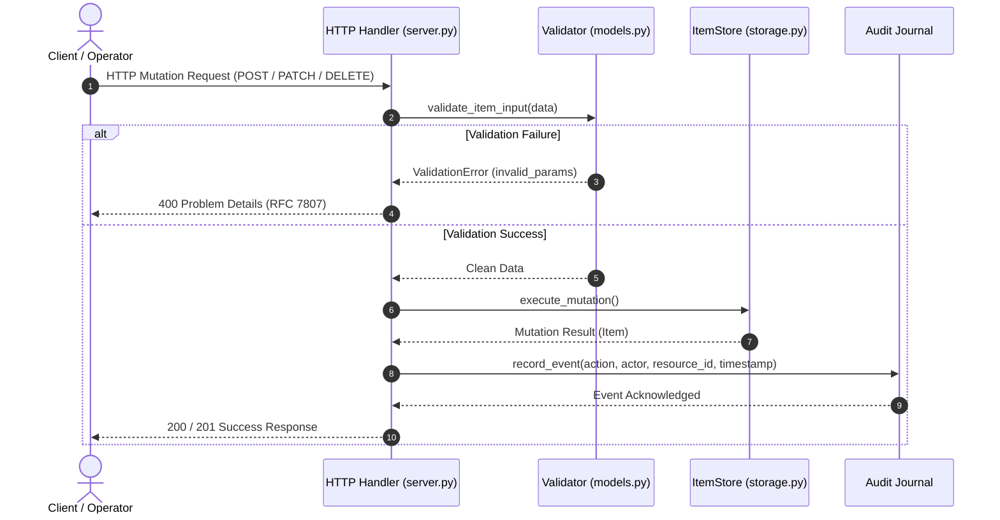

# Design: Audit Logging System (After Rule Applied)

## Context
See proposal.md - Why. Current system lacks centralized audit trail for state-mutating requests.

## Goals / Non-Goals

**Goals:**
- Record audit event on every POST, PATCH, DELETE and export request.
- Log event timestamp, actor, action, and resource id.

**Non-Goals:**
- External SIEM integration.

## Decisions

- **Decision 1: Synchronous logging to audit journal buffer**
  - *Rationale*: Low complexity, zero external dependencies.
- **Decision 2: JSONLines format for audit logs**
  - *Rationale*: Easy to parse and stream.

## Architecture and Interaction (Mermaid Diagram)

## Risks / Trade-offs

- *[Risk: Disk I/O bottleneck]* → *Mitigation*: Append-only JSONL writes with buffered stream flush.
